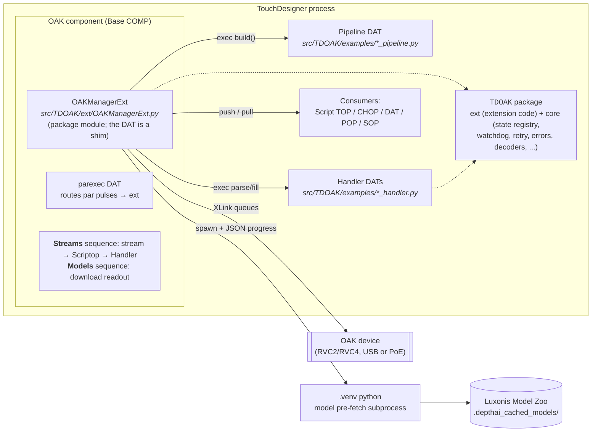
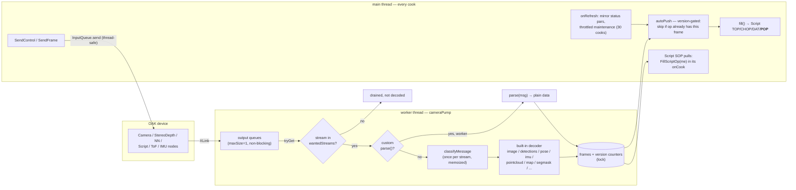
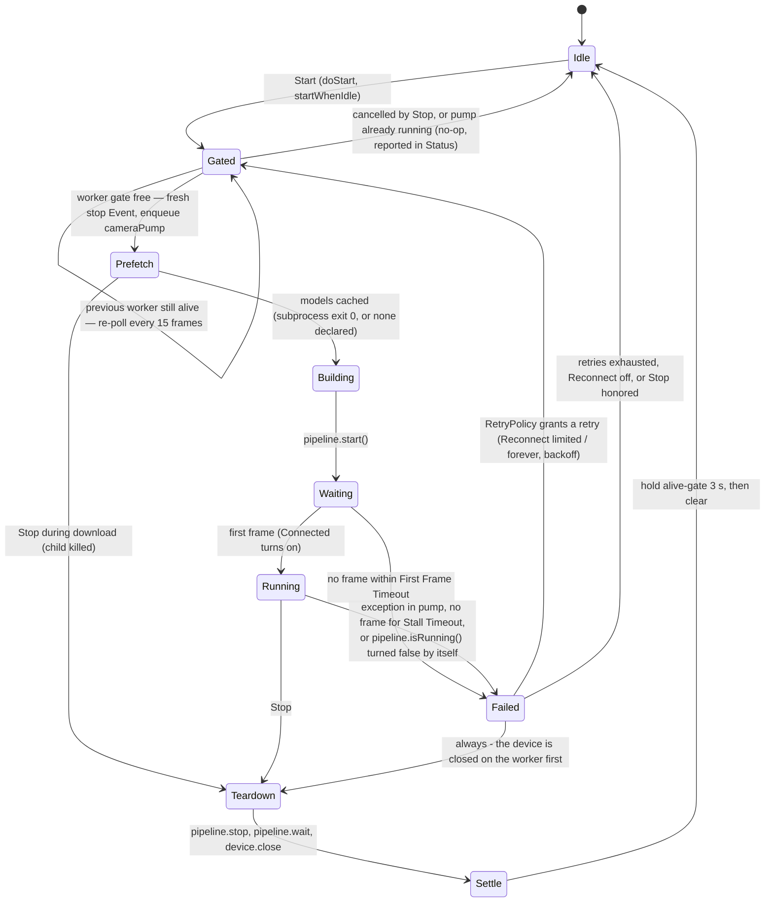
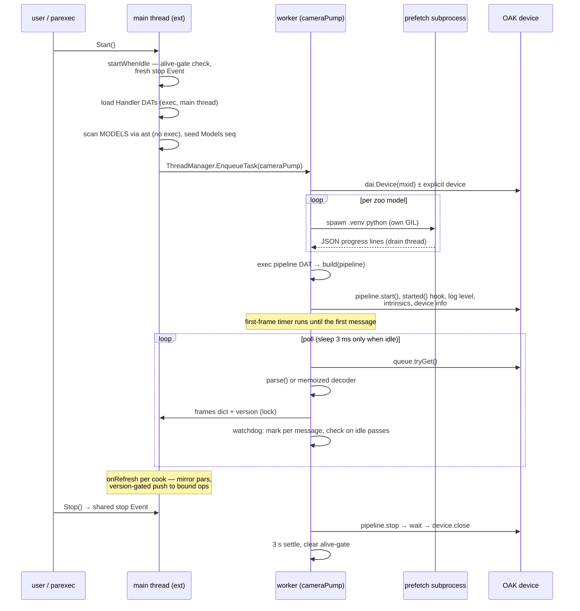

# TDOAK Architecture

Developer documentation for the TDOAK TouchDesigner ⇄ OAK camera integration.
This describes how the pieces fit together, which thread everything runs on, and the
invariants you must not break — several of them exist because violating them
**hard-crashes the TouchDesigner process** in native depthai code, with no Python
traceback to help you.

For the user-facing API reference (parameters, method signatures, frame formats),
see the [README](../README.md).

---

## 1. System overview

TDOAK bridges Luxonis OAK cameras (depthai v3) into TouchDesigner. A single Base COMP
(`/project1/TDOAK` in the demo project) owns everything: it opens the device, runs a
user-supplied **pipeline script** on it, decodes the resulting streams off the main
thread, and delivers plain data into bound Script Operators every cook.



Key sources:

| Path | Role |
|---|---|
| `src/TDOAK/ext/OAKManagerExt.py` | The extension: lifecycle, worker pump, delivery into operators. A regular package module — the component's `OAKManagerExt` DAT is a shim calling `TDOAK.ext.create('OAKManagerExt', me)`. |
| `src/TDOAK/ext/CameraControlExt.py` | Extension of the OAKCameraControl component — builds `dai.CameraControl` messages from custom parameters and sends them via `SendControl`. Same shim pattern. |
| `src/TDOAK/ext/__init__.py` | `create()` (used by the shims) and `reloadChanged()` — the development reload of changed `core`/`ext` modules on Re-Init Extensions. |
| `src/TDOAK/__init__.py` | Package metadata + resource API: `__version__` (single source of truth for releases), `toxPath()`/`toxPaths()` for the packaged `.tox` components (`TDOAK`, `TDOAKCamCtl`, `TDOAKStream`), `examplesPath()`/`assetsPath()`. |
| `src/TDOAK/core/state.py` | `workerState()` registry — per component, for the life of the process: `alive`/`stop` Events, the pump thread, the owning extension instance, a pending-restart deadline (survives extension re-inits). |
| `src/TDOAK/core/watchdog.py` | `FrameWatchdog` — first-frame and stall detection, per-stream ages. |
| `src/TDOAK/core/retry.py` | `RetryPolicy` — the Reconnect modes, backoff, healthy-run reset. |
| `src/TDOAK/core/errors.py` | The two-channel `ErrorLog`, `formatTaskError`, failure hints, `PipelineError`, crash-dump summary. |
| `src/TDOAK/core/decode.py` | Built-in decoders that need no TD object: image orientation/colour order, detections, IMU, point clouds. |
| `src/TDOAK/core/models.py` | `ast` scan of a pipeline script: declared models, watchdog overrides. |
| `src/TDOAK/core/device.py`, `env.py`, `compat.py`, `update.py` | Device readout + USB-speed warning; interpreter lookup for the pre-fetch; tested depthai range; update check. |
| `src/TDOAK/core/constants.py` | Constants shared across the device boundary (e.g. `HAND_CROP_PADDING`, used by both `hand_pipeline.py` and `hand_handler.py`). |
| `src/TDOAK/examples/*_pipeline.py` | Pipeline scripts — each defines `build(pipeline)` (see §5). Loaded via the **Pipeline DAT** parameter. |
| `src/TDOAK/examples/*_handler.py` | Per-stream Handler DATs — optional `parse` / `fill` (see §6). |
| `src/TDOAK/examples/*_top.py`, `.../data_chop.py` | Example Script-operator cook callbacks (pull style). |

The pipeline and handler DATs in the demo project are file-synced (`syncfile=on`) to the
example files: edit the file, TD reloads the DAT.

**The extension is deliberately NOT a file-synced DAT.** TouchDesigner recompiles a DAT
module by *clearing its namespace and re-executing the text into the same dict*. A worker
thread running code from that module loses every global mid-flight — `time`, `suppress`,
its own constants — and dies with a `NameError` inside the device teardown, without
closing the device and (before the gate was hardened) without clearing the alive-gate:
the "Start does nothing until TouchDesigner restarts" bug. A package module is never
recompiled behind a running thread's back. `importlib.reload` (what `reloadChanged()` uses)
re-executes into the module dict *without* clearing it, so even a reload under a running
worker leaves it with valid globals.

Development loop: edit `ext/` or `core/`, pulse **Re-Init Extensions**. `create()` reloads
the changed modules (core before ext); the new instance finds the old run still alive,
stops it, and starts a fresh one — a re-init behaves like Rebuild (§4).

`core/` has no TouchDesigner or depthai imports and is unit-tested with plain `pytest`
(`tests/`). When you add logic that doesn't need a TD object, put it there.

---

## 2. Threading model

Three execution contexts. The comment banner in `OAKManagerExt.py`
(`# ── Background thread — NO TD object access below this line ──`) marks the split.

| Context | Runs | May touch TD objects? | May call blocking depthai? |
|---|---|---|---|
| **Main thread** | ThreadManager hooks (`onRefresh`, `onSuccess`, `onExcept`), all public API, handler `fill`, par mirroring | yes | **no** — `device.close()` / `pipeline.stop()` here freezes the UI for frames |
| **Worker thread** (`cameraPump`, one per run, via TD's `ThreadManager.TDTask`) | device open/close, model prefetch orchestration, `build()` exec, the poll loop, all decoding, handler `parse` | **never** (`op()`, `me`, `run()`, pars — all forbidden) | yes — that's its job |
| **Prefetch subprocess** (`.venv` interpreter, one per zoo model) | `dai.getModelFromZoo` download | n/a (separate process) | n/a |

Why a subprocess for downloads: the zoo resolve/download is Python-level work that
**holds the GIL**. On the worker thread it still froze TD (worker and TD share one
interpreter). A child process has its own GIL; it streams JSON progress lines over
stdout, which a small drain thread parses into the `Models` sequence readout.

**Cross-thread state** is one `threading.Lock` guarding plain dicts on the instance
(`_frames`, `_frameVersions`, `_lastError`, `_controlQueues`, `_intrinsics`,
`_modelProgress`, status fields). Two structures are read **lock-free** by the worker
and therefore follow a strict *swap-never-mutate* rule:

- `_parsers` (stream → parse fn) and `_wantedStreams` (set) are only ever **replaced
  whole** under the lock on the main thread; the worker reads the reference atomically.
  Never mutate a published dict/set in place.

---

## 3. Data flow — device to operator



Points that matter to a maintainer:

- **Latest-frame semantics.** All queues are `maxSize=1, blocking=False`. The pump
  drains one message per queue per pass; a deep queue would serve stale frames.
- **Decode-on-demand.** `_wantedStreams` = bound streams ∪ streams ever pulled via
  `GetFrame` ∪ streams with a registered `parse` ∪ `'rgb'` (drives the Fps readout).
  Unwanted streams are drained (so the device never backs up) but not decoded.
  First `GetFrame(name)` on an unbound stream registers interest; data arrives next frame.
- **Decoder memoization.** A queue's message type never changes in practice, so the
  pump classifies each stream's first message (`classifyMessage`) and dispatches through
  a dict thereafter. Decoding keys off the **message type**, never the stream name
  (except the rgb BGR→RGB display swap).
- **Version gating.** `pushFrame` bumps a per-stream counter; `autoPush` records the
  last version written per `(op, stream)` and skips identical re-pushes. With a 30 fps
  camera in a 60 fps project, half of all cooks push nothing — by design.
- **Push vs pull.** Script TOPs/CHOPs/DATs/**POPs** are pushed from `onRefresh`
  (POP staging — `createGeometryStagingData`/`buildGeometry` — works outside the cook).
  Script **SOPs** are the only pull consumers: geometry must be built inside their cook,
  so they call `FillScriptOp(me)`.
- **Maintenance throttling.** Autoreload hashing (pipeline DAT + every handler DAT
  text) and the binding-cache rebuild run every `MAINTENANCE_PERIOD` (30) cooks, not
  per cook. Register/Reload calls rebuild immediately.

---

## 4. Lifecycle — the part that crashes if you get it wrong



The teardown sequence is load-bearing. **Every step below was added after a real,
reproducible cold crash of the TouchDesigner process:**

1. **Teardown happens on the worker**, in `cameraPump`'s `finally` — never in the
   main-thread hooks. `device.close()`/`pipeline.stop()` block for frames.
2. **`pipeline.wait()` between `stop()` and `device.close()`.** `stop()` only signals;
   the pipeline's host-side node threads are still processing. Closing the device
   underneath them is a native race → cold crash on a plain Stop.
3. **3-second settle after `close()` returns** (`POST_CLOSE_SETTLE_S`). XLink keeps
   tearing down in native code after `close()` returns; reopening the device inside
   that window crashes the process. The worker holds the alive-gate through the
   settle, so no deferred Start can reopen too early.
4. **Per-run stop Events, per-run device handles.** Each run gets a fresh
   `threading.Event`; the pump's handles travel through locals (a `handles` dict),
   never instance attributes. A dying run can only ever close *its own* device, and a
   new Start can never un-stop a run that's still winding down.
5. **The worker state (`alive` + current `stop` Event) lives in the `TDOAK` package**
   (`TDOAK.core.state.workerState(compPath)`), not on the extension instance. Extension re-inits
   (DAT edit, `reinitextensions` pulse) create a fresh instance — it must still *see*
   and be able to *stop* the previous instance's running pump. Without this, a Start
   right after reinit raced the old teardown (crash #1 of this project's history).
6. **The deferral path never touches another run's stop flag.** If a pump is alive and
   nobody asked it to stop, `Start` is a **no-op** (restart is `Rebuild`'s job). An
   earlier version force-set the stop flag while deferring; with two concurrent start
   chains (a user Start plus an `onExcept` retry) each killed the other's freshly
   booted pump — a livelock that doubled as an open/close hammer on the device.

7. **The alive-gate is cross-checked against the thread, and cleared in the innermost
   `finally`.** `core.state.isWorkerAlive()` treats a set flag whose recorded pump thread
   has exited as stale and clears it; `cameraPump` binds everything its teardown needs to
   locals and clears the flag in a nested `finally`. Nothing that goes wrong in the
   teardown may leave the gate set — a stuck gate turns every later Start into a no-op.
8. **One owner.** Each new extension instance claims the component in the shared state
   (`owner`). Hooks and delayed callbacks of a superseded instance (`onRefresh`,
   `onSuccess`, `onExcept`, a scheduled retry) check `isOwner()` and stand down, so two
   instances never drive the parameters or start pumps against each other.
9. **A re-init is a Rebuild.** `onDestroyTD` of the old instance and `__init__` of the new
   one both stop a still-running pump; the wish to restart travels through the shared
   state as a *deadline* (`requestResume`), because TouchDesigner can initialize an
   extension more than once per reload and only the last instance survives to restart. A
   deadline rather than a flag, so a component destroyed for good leaves nothing stale.
10. **Delayed starts carry a token.** Retries, Rebuild and the re-init restart are scheduled
    with `run(...)` and the `_startToken` current at that moment; `Stop`/`Start` bump it.
    A stale delayed start stands down — Stop during a retry wait really cancels the retry.
11. **A failed run never hands its traceback to the main thread.** ThreadManager stores the
    exception it is given; a traceback pins `runPipeline`'s frame — pipeline, device,
    queues — whose native destructors would then run on the main thread, possibly after a
    retry reopened the device. `cameraPump` keeps the message, clears the frames, tears
    down, and raises a fresh `PipelineError` (full text: `GetLastTraceback()`).
12. **Control queues are unpublished before the pipeline stops**, so a per-frame
    `SendFrame` on the main thread can't send into a pipeline that is tearing down; and
    **device discovery is not run while a pump is booting or closing** (same native race
    as reopening inside the settle window).

**What counts as a failure.** Besides an exception in the pump: no frame at all within
*First Frame Timeout* of `pipeline.start()`, no frame on any stream for *Stall Timeout*,
and `pipeline.isRunning()` turning false while nobody pressed Stop (a lost device or a
firmware crash — it used to end the run silently as if stopped). A single stream going
quiet while others flow is a warning. A stream that has not delivered anything yet gets
the first-frame allowance — a ToF depth stream starts seconds after the colour stream.
`Connected` means *frames are arriving*; it turns on with the first message.

**Autoreload does not depend on the pump.** `onRefresh` (the pump's RefreshHook) only runs
while a run is alive, so a `maintenanceTick` chained with `run()` for the life of the
instance restarts the pipeline when the Pipeline DAT changes while nothing is running —
after a failed build, exactly when it is needed.

Start-up sequence in full:



---

## 5. Pipeline script contract

A Pipeline DAT replaces the built-in auto-detect pipeline. It is exec'd **on the
worker** with `dai` in scope (and compiled with the DAT's path, so tracebacks point
at the real DAT). It must define:

```python
def build(pipeline: dai.Pipeline) -> tuple[
    dict[str, dai.DataOutputQueue],   # {stream name: output queue}   required
    list[str],                        # ordered stream names          required
    dict[str, dai.InputQueue],        # {control name: input queue}   optional
]
```

- Output-queue keys become stream names (`GetFrame(name)`, Streams menus).
- Control-queue keys become `SendControl`/`SendFrame` targets. Create them with
  `createInputQueue(maxSize=1, blocking=False)` — latest-value semantics.
- **`MODELS = [...]`** (or `MODEL = '...'`) at module level declares models for
  pre-fetch. It is discovered by **statically parsing the script with `ast`** — the
  script is *not* executed for the scan. Literals and references to other module-level
  literal assignments resolve (`MODELS = [PALM_MODEL, HAND_MODEL]` works); computed
  values are skipped and resolve inline in `build()` instead (which briefly holds
  the GIL — declare when you can). Entries that resolve to existing files are local
  NNArchives (no download).
- With no script, `buildPipeline` probes the device: ToF sensor on CAM_A → ToF
  pipeline; otherwise RGB camera, plus StereoDepth / IMU when the pars enable them.

## 6. Handler contract

A Streams block optionally names a **Handler DAT** defining either or both:

```python
# In scope: dai, np, oak (the OAK component — use it to reach the promoted API,
# e.g. oak.GetIntrinsics(...); a bare op('...') here resolves INSIDE the component).

def parse(msg):            # WORKER thread. depthai message -> plain data. No TD access.
def fill(scriptOp, data):  # MAIN thread. plain data -> the bound operator.
```

- `parse` **overrides** the built-in decoder for its stream (keyed by stream — one
  physical queue, one parse; last registrant wins). Omit it to keep the default decode.
- `fill` is keyed by the **bound op's path** (one fill per op). Omit it for the
  default push (ndarray → Script TOP via `copyNumpyArray`).
- Handlers are exec'd on the **main thread** at load (Start / `ReloadHandlers()` /
  autoreload); the resulting callables hot-swap into the running pipeline — `parse`
  via the whole-dict swap the worker picks up next message, `fill` on the next cook.
  Only a new *physical* stream (a `build()` change) needs a `Rebuild`.
- Handler errors are caught and reported to `Lasterror` (`parse[stream]: ...`,
  `fill[stream]: ...`); a failing handler never stalls the pump. Type-guard your
  `fill` input anyway — a block bound to the wrong stream should degrade silently
  (see `src/TDOAK/examples/*_handler.py` for the pattern).

Registration has two equivalent entry points: the **Streams sequence** (UI) and the
**component registry** (`RegisterComponent` / `RegisterHandler` / `RegisterScriptop`
for self-wiring components). Component registrations survive sequence reloads and win
on conflict (`applyHandlers` composes the two).

## 7. Error handling & observability

- **Two channels**, both in `core.errors.ErrorLog` behind the instance lock and shown with
  the time they were set:
  - `setError()` → **Lasterror** — why the pipeline is *not running*. Set by `onExcept`
    (with a hint for known depthai failure texts), the no-device check and enumeration
    failures. Kept until the next Start/Rebuild/Autoreload restart, so after an automatic
    reconnect it still says what the interruption was.
  - `setWarning()` → **Lastwarning** — a problem the pipeline *survives*: handler
    `parse`/`fill`/exec errors, a quiet stream, a USB2 link, a failed model pre-fetch, an
    undecodable message type, a `SendControl` that raised. Latest wins; cleared on
    Start/Rebuild, handler warnings also on `ReloadHandlers`.
  Worker-side messages are mirrored by `onRefresh`; main-thread messages also write the
  pars immediately. Every distinct message is printed to the textport once.
  Message shape: `context[subject]: detail`.
- **`PipelineError`** marks failures TDOAK detects itself (stall, lost device): shown as
  their bare text. Anything else is rendered `Type: message (file:line in function)` from
  the innermost frame — for a pipeline script that is the DAT and line in `build()`.
- **Status** (`setStatus`, same thread split) is the lifecycle readout; **Deviceinfo** the
  connected device and link speed.
- **Retry policy.** `core.retry.RetryPolicy`, created fresh by Start/Rebuild/Autoreload
  restart from the `Reconnect` par: `off`, `limited` (3 attempts in a row), `forever`
  (backoff 5-60 s). A run that streamed 30 s resets the count. Never overrides a Stop.
- **Log verbosity.** The `Loglevel` par (default `warn`) is applied to the device on Start
  (`setLogLevel` + `setLogOutputLevel`) — it gates depthai's periodic `[info]`
  temperature/CPU chatter.
- **Status snapshot.** `GetStatus()` returns `{connected, fps, latency_ms, error, warning,
  streams, status, stream_age}`. Fps is measured on the rgb stream (else the first
  stream) once per second and drops to 0 when it goes quiet; latency is measured against
  `dai.Clock.now()` (device timestamps share *its* epoch, not `time.monotonic()`).
- **Parameters are read directly** (`par.Name`). The `.tox` ships inside the package next
  to the code that reads it, so there are no "older comp without this par" fallbacks.

## 8. Known sharp edges

- **Crash-safety env guards.** The first lines of `OAKManagerExt.py` set (via
  `setdefault`, before the first depthai import): `DEPTHAI_INSTALL_SIGNAL_HANDLER=0`
  (depthai's bundled handler otherwise replaces TD's crash reporting — TD then vanishes
  with no dump), `DEPTHAI_CRASHDUMP=0` (skips the post-close device-crash-dump check that
  reconnects during teardown), and `DEPTHAI_RECONNECT_TIMEOUT=0` (XLink auto-reconnect
  races Stop teardown and aborts the process). They are process-global and only take
  effect for values not already set in the TD process — changing them needs a TD restart.
  Background: `docs/luxonis-crash-report.md`. The opt-in `Crashdump` par reads a pending
  dump explicitly on the *next connect* instead (`hasCrashDump`/`getCrashDump`).
- **AutoCalibration.** depthai injects AutoCalibration/DynamicCalibration/Gate nodes into
  any pipeline with a `StereoDepth` node (library default `ON_START`). On an OAK-D Lite
  with depthai 3.12.2 that crashes the device firmware about 2 s after start (RTEMS assert
  in `RefCnt::DecRef`, thread `PlgXLinkIn`) — seen as `MessageQueue was closed` or as
  `pipeline.isRunning()` turning false. The `Autocalibration` par therefore defaults to
  Off and is applied with `pipeline.setAutoCalibrationMode()` before `build()` (a script
  can override it). The `DEPTHAI_AUTOCALIBRATION` environment variable is only honoured
  when set before depthai is first imported, so it can't be relied on from an extension.
  Draft upstream report: `docs/luxonis-oakdlite-mono-regression.md`.
- **Python host nodes lose their type inside TouchDesigner.** With depthai 3.12.2 in
  TouchDesigner 2025.33230 (Python 3.11.15), `pipeline.create(<Python subclass of
  ThreadedHostNode>)` returns a bare `depthai.node.ThreadedHostNode` — every depthai-nodes
  pipeline fails with `'ThreadedHostNode' object has no attribute 'build'`. The same
  depthai under a stock Python 3.9 does not show it. `installHostNodeKeepAlive()` probes
  for the breakage and, only when present, wraps `Pipeline.create` to hold a reference to
  each Python host node for the run. It reports itself in Lastwarning when it was needed.
  Re-check after every depthai or TouchDesigner update; remove it when the probe stays
  healthy.
- **Model pre-fetch on macOS.** A stand-alone interpreter from a venv created by
  TouchDesigner cannot load `depthai.*.so` (code-signing: different Team IDs), so the
  pre-fetch subprocess always fails there and models are fetched in-process — a warning,
  not an error. The interpreter is looked up from the venv depthai was loaded from, then
  `<project>/.venv`; TouchDesigner's `sys.executable` is never used.
- **Menu pars store selections by index.** `updateStreamMenus` builds the Stream menu as
  the union of active streams and every block's current selection, and `setDeviceMenu`
  keeps the selected device in the Device menu even when it isn't visible; both re-assign
  *by name* after a rewrite. A naive menu rewrite silently re-points the selection.
- **Custom pars next to a sequence.** Appending a custom par to the Device page puts it
  behind the `Models` sequence and breaks the sequence's block (its `Progress` par
  vanished). Remove the sequence, add and sort the pars, then re-create it
  (`appendSequence('Models')`, pars `Model` + `Progress`, `seq.blockSize = 2`).
- **One OAK component per project** is the tested configuration. The zoo cache env
  vars (`DEPTHAI_ZOO_CACHE_PATH`, `DEPTHAI_ZOO_INTERNET_CHECK`) are process-global,
  and the workerState registry is per component path.
- **POP staging outside the cook** is how POPs are filled (proven by the skeleton
  showcase). If TD ever crashes during steady running — not stop/start — suspect this
  path first and unbind the POP block to isolate.
- **Pipeline scripts run on the worker** with only `dai` and `PROJECT_FOLDER` in scope —
  no `op`, `project` or `me`.

## 9. Extending

| You want to… | Do |
|---|---|
| Support a new model | Write a pipeline script (`build()` + `MODELS`); if its output message type is already decoded (see `_decoders` in `OAKManagerExt.py`), you're done — otherwise add a Handler `parse`. |
| Decode a new depthai-nodes message type natively | Add a kind to `classifyMessage` + a `decodeX(msg, name)` method + a `_decoders` entry. Keep decoders pure (no TD access) and return plain data; put the conversion itself in `core/decode.py` so it can be unit-tested with a fake message. |
| Feed a new operator family | Check whether it accepts writes outside its cook. If yes, it's push (nothing to do — bind it with a `fill`); if not, follow the SOP pull pattern (`FillScriptOp`). |
| Add a component parameter | Add the custom par to the `.tox` (settings go on the **Tune** page, with help text; mind the sequence caveat in §8), read it in `readConfig()` as `par.Name`, and ride it to the worker inside `PipelineConfig` — the worker must never read pars. Save the `.tox` with neutral values. |
| Add a pulse | Add the pulse par and an `OnPulse<Parname>` method — the component's parexec dispatches every custom pulse by name. |
| Add logic that needs no TD object | Put it in `src/TDOAK/core/` with a test in `tests/`. |
| Change lifecycle behavior | Re-read §4 first. Every invariant there maps to a specific crash that was reproduced on hardware. |
